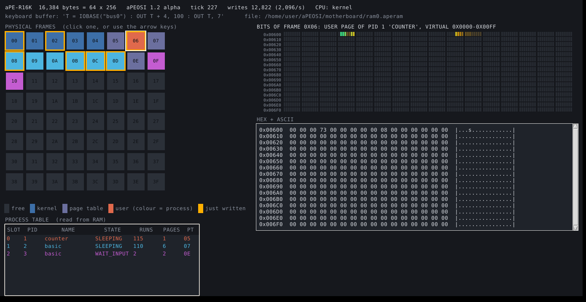

# aPEOSI

## ahfuba's Python Emulated Operating System Interface

[](https://github.com/ahfuba/aPEOSI/actions/workflows/tests.yml)

**A simulated computer and operating system in Python, where you can watch every bit.**
Its RAM is a file that a second program shows live. Its hardware is made of
swappable modules you can design yourself. It runs its own BASIC, and devices
with real logic (a timer, a serial port) plug into its motherboard's sockets.



*aPE-Watchdog looking into aPEOSI's RAM while it runs: every physical frame
(coloured by the process that owns it), the bits of one page flipping as a
counter counts, and the process table, all read straight from the RAM file.*

## Try it

You need Python 3.10 or newer; nothing else to install.

```bash
python main.py
```

In a second window, to watch the RAM (needs Python's built-in `tkinter`):

```bash
python ape_watchdog.py
```

Then type in aPEOSI:

```
basic basic/guess.bas      a number-guessing game in aPE-BASIC
counter &                  a binary counter in RAM: watch its bits in aPE-Watchdog
basic basic/timer.bas      program the timer chip and watch it interrupt
ps                         processes, read from the process table in RAM
lsdev                      what is plugged into the motherboard
help                       every command
```

Add `--fast` to `main.py` to skip the boot delays and the memory test. On Windows, `py` works instead of `python`.

```
Booting aPEOSI System...
Motherboard: aPE-B1 Classic
CPU:         aPE-P1 @ 200 Hz
RAM:         aPE-R16K, 16,384 bytes (64 x 256-byte frames)
Sockets:
  bus0   BUS  aPE-T1 Timer   TIMER     io 0x0000-0x000F   irq 0
  bus1   BUS  aPE-U1 UART    UART      io 0x0020-0x003F   irq 1
  pci0   PCI  (empty)
  com1   SER  aPE-E1 Echo    ECHO
...
aPEOSI 1.2 A:/> basic basic/hello.bas
HELLO FROM aPE-BASIC!
1 SQUARED IS 1
2 SQUARED IS 4
```

## What's inside

| | |
|---|---|
| **An OS you can see** | processes, a round-robin scheduler, system calls, virtual memory with page tables and demand paging. The OS keeps all of it *inside the RAM file*, so aPE-Watchdog can show it. [How it works](docs/how-aPEOSI-1.2-works.md) |
| **Modular hardware** | a `/motherboard` folder of swappable CPU and RAM modules, checked at boot by a small "BIOS". [Modding guide](motherboard/README.md) |
| **Sockets and devices** | a system bus, PCI slots and serial ports. Devices with real logic plug in: a timer that raises interrupts, a UART that sends bytes at a real baud rate, an echo plug on COM1. Each device *is* a live file. [Socket spec](docs/aPE-Socket.md) |
| **aPE-BASIC** | a 1980s-style BASIC with `PEEK`/`POKE`, `INP`/`OUT`, and keywords that see the hardware and the process table. [Reference](docs/aPE-BASIC.md) |
| **aPE-DevKit** | design your own devices in Python or JSON: registers, bit fields, memory, logic. It checks the design and compiles it. [Guide](docs/aPE-DevKit.md) |
| **aPE-Watchdog** | a separate program that watches the RAM live. `ape_devkit.py info --watch` does the same for any device. |

## Documentation

| Document | About |
|---|---|
| [How aPEOSI 1.2 works](docs/how-aPEOSI-1.2-works.md) | a guided tour of the OS, concept by concept |
| [aPE-BASIC](docs/aPE-BASIC.md) | the language |
| [aPE Socket](docs/aPE-Socket.md) | sockets, devices, interrupts, I/O ports: the hardware contract |
| [aPE-DevKit](docs/aPE-DevKit.md) | building your own devices |
| [Hardware formats](docs/aPE-hardware.md) | the binary file formats |
| [Modding guide](motherboard/README.md) | swapping and making hardware parts |
| [Naming scheme](NAMING.md) | how everything in aPEOSI is named |
| [Roadmap](ROADMAP.md) | where the project is going |
| [Testing](TESTING.md) | running the tests |

## Status

**Alpha.** It works, and every push is tested automatically on Windows, Linux
and macOS (the badge above), but expect rough edges. Known issues are listed in
the [roadmap](ROADMAP.md#-known-issues).

### Why?

Well, at first I was going to program something similar to "simulator"s you see on Scratch, or a Windows Simulator/Starter you see on Android. Which, is either just a fancy "file explorer", thus not being fit for the name of an OS Simulation; or a simulation made in a game engine with only the graphical elements and some basic functions, again not being fit to be a complete OS simulation in my opinion. 

Therefore I decided to program something from scratch to learn the basics of kernel/OS development, acting as if Windows is the BIOS/Bootloader. (some of my friends called me a masochist)

Afterwards, I went and decided to program something sees a `\disks` folder from Windows (or any other OS you are using) file system as Devices/Disks connected to the "virtual" computer. (Well, this isn't a virtual machine, so it's just going to inherit the system information of your own computer) You will be able to change the disk/device type by editing a config file inside the folder.

There is a base kernel that works, not same, but similar to a kernel. The model I was inspired was Windows NT, because it was more of a closed ecosystem and well a sstem I like more than Linux kernel's file system (please don't execute me Arch fans) which was perfect for such a project.

Well, I actually got this "kernel inspiration" idea by asking. I certainly don't know what I am doing or why I am doing this. So... um... yea.

A Python based DOS/OS Simulator, made for fun and understanding WHY Python is really unfit for programming operating systems/kernels that require less consumption of system resources, which allows users to execute commands or run applications without the limitation of resources.

It also is a project to understand the fundamentals of the front-end of an OS.

This is a fun project. It needs a computer with an already installed operating system; and also a Python installation.

### How does it work?

The way it works is, first and foremost, carcinogenic. Python is a high-level language, making it REALLY heavy and resource-intensive, which makes this simulation WAY slower than a simulator written in C, C++, or any other low- to mid-level language.

The details are in the [guided tour](docs/how-aPEOSI-1.2-works.md).

### History: the alpha-1 design

*The original design, before aPEOSI 1.2 replaced it with processes, aPE-RAM and sockets:*

> The whole aPEOSI runs on a task called MAIN. The task manager first schedules the MAIN task and prepares the related task run-lanes, when the app is booted up.  A run-lane means any task related to the current task and their paths and variables are stored beforehand any possible launch choice of the user.
>
> After the MAIN task launches, user basically chooses system tasks or other application tasks that may be launched over the MAIN task itself. MAIN task works in turns with the task manager, which basically, MAIN task works as an interface for the user, and task manager is the backend for it.

---

**IMPORTANT:** Any harm done by files or applications run by my app is out of my responsibility. Use the app at your own risk. Execute programs or open files at your own risk. The applications I put within the OS interface are ~~hopefully~~ safe, so you can run them pretty much without too many risks. However, if you are running any kind of a modified version of aPEOSI, I strictly reject any form of responsibility, even though the problems are caused from the unedited parts of the code.

###### This app is licenced under MIT License.
###### Make sure you give attribution when using/modifying it. You are free to do so.
